# ERP — Module Fournisseur

Projet de semestre, matière ERP. Le module Fournisseur gère tout le cycle d'achat de l'entreprise : du besoin d'achat jusqu'au fournisseur payé.

**Équipe :** Maram Chaouch · Eya Touati · Shahd Kdaiem · Eya Ferah

| Sous-processus | Rôle |
|---|---|
| A · Fournisseurs et catalogue | Créer, évaluer ou désactiver un fournisseur |
| B · Consultation | Du stock bas à l'offre retenue |
| C · Commande et réception | De l'offre retenue à la réception validée |
| D · Facturation et paiement | De la réception au fournisseur payé |

**Technologies :** Java 17 · Spring Boot 3 · PostgreSQL · Thymeleaf · Bootstrap

## Documents

| Document | Lien |
|---|---|
| Conception BPMN | [Ouvrir le PDF des diagrammes](docs/01-conception/diagrammes-bpmn.pdf) · [Source draw.io](docs/01-conception/moduleFournisseur.drawio) |
| Présentation | [Ouvrir le PDF](docs/02-presentation/Presentation.pdf) |
| Choix des technologies | [Ouvrir le PDF](docs/04-technologies/choix-des-technologies.pdf) |

## Organisation du dépôt

```
docs/
├── 01-conception/      diagrammes BPMN (.drawio, PDF, captures)
├── 02-presentation/    présentation (PDF et slides)
└── 04-technologies/    choix des technologies
src/                    code Spring Boot (à venir)
```

## Conception BPMN

Un workflow (l'achat), découpé en 4 sous-processus : A, B, C et D.

### Niveau 1 — vue globale
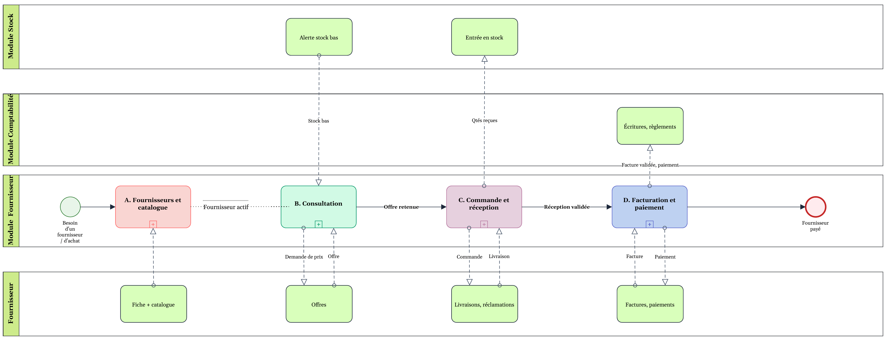

### Vue complète
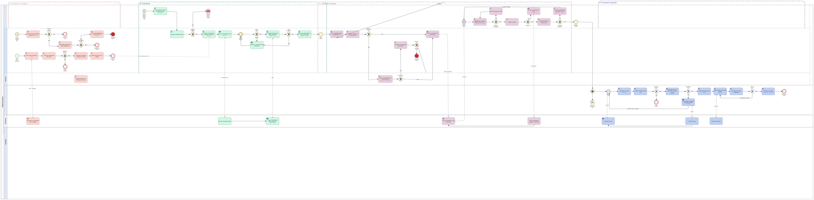

### A — Fournisseurs et catalogue
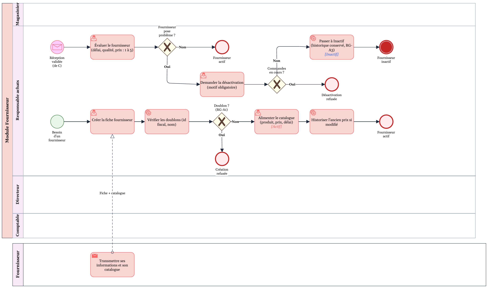

### B — Consultation
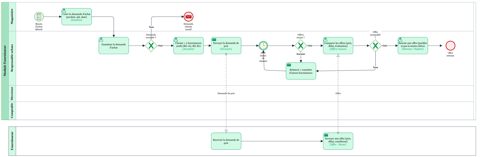

### C — Commande et réception
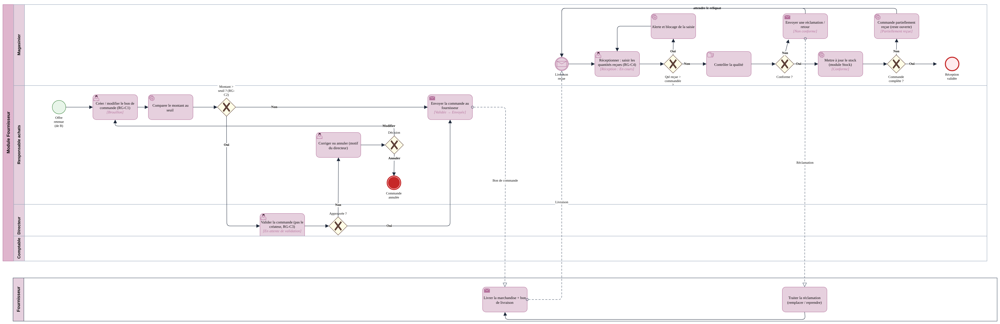

### D — Facturation et paiement
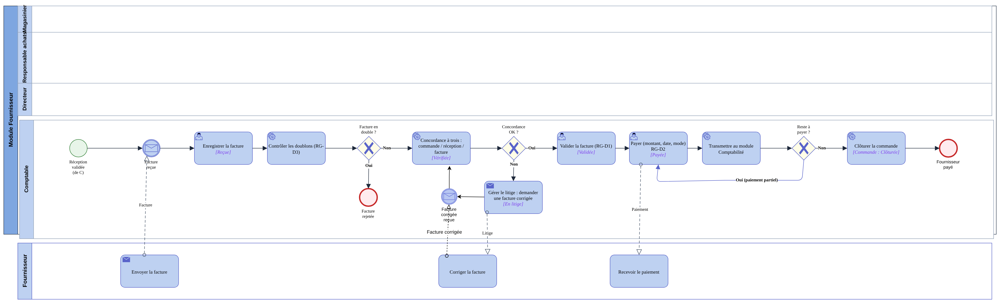

## Présentation


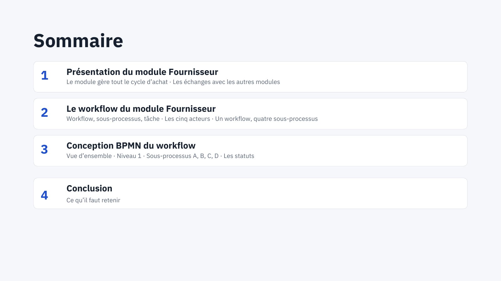
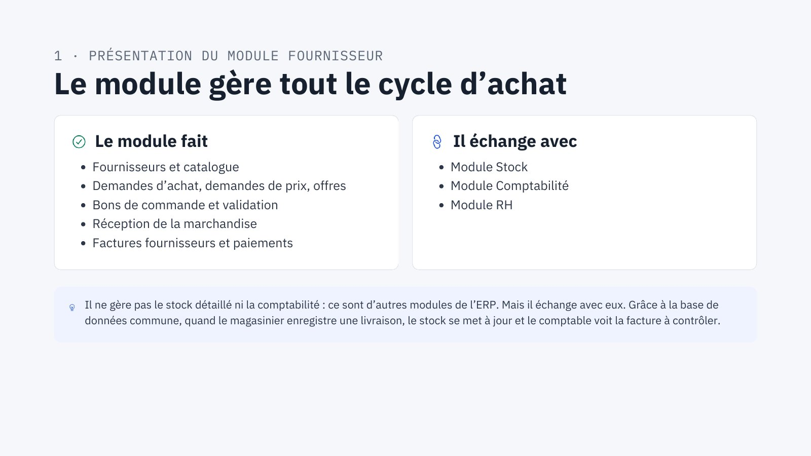
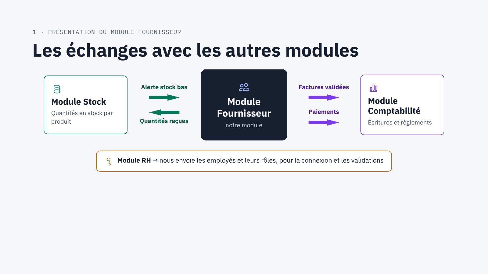
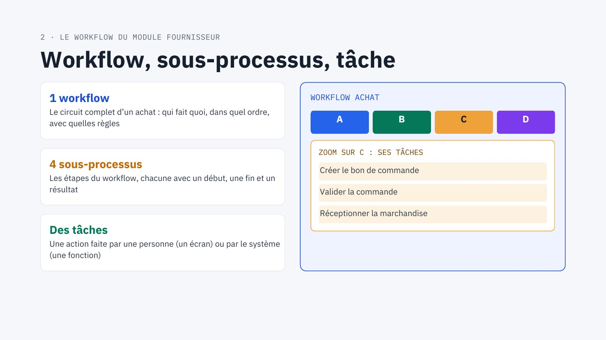
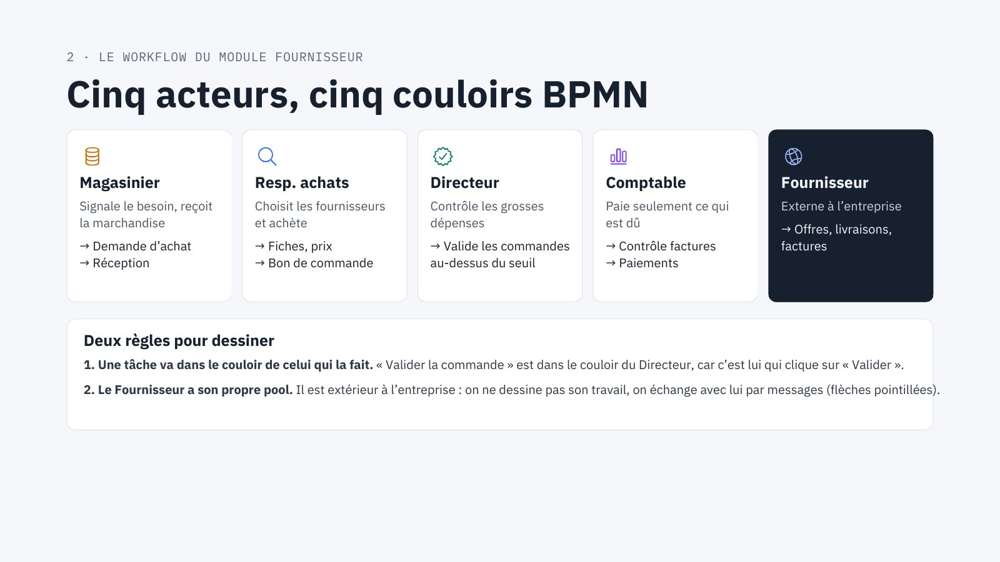


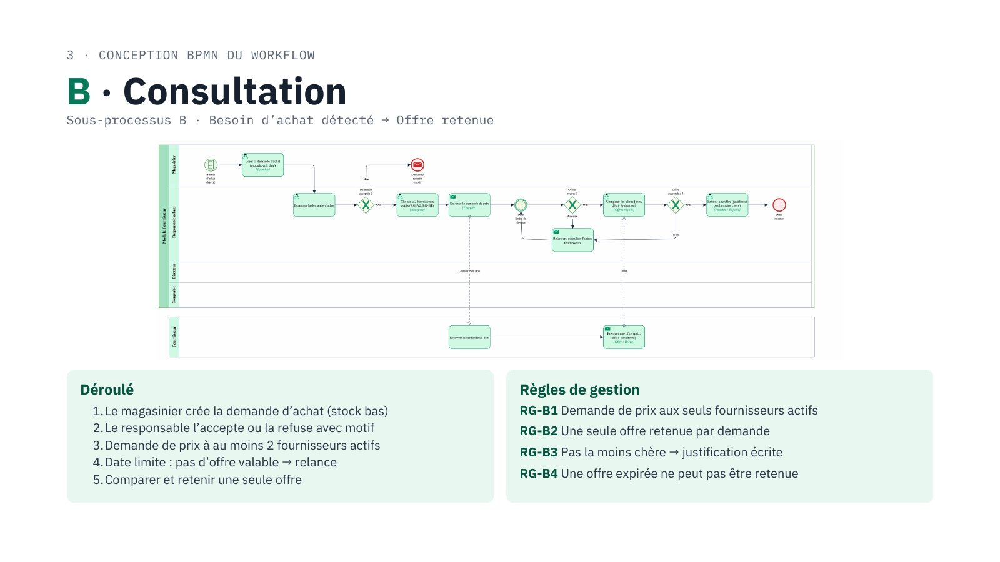


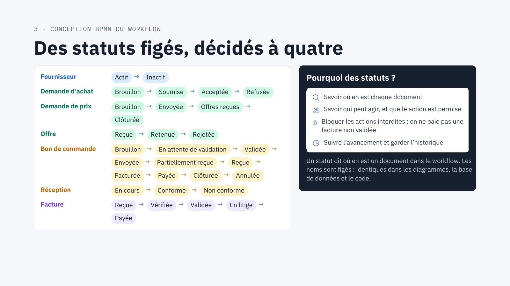


