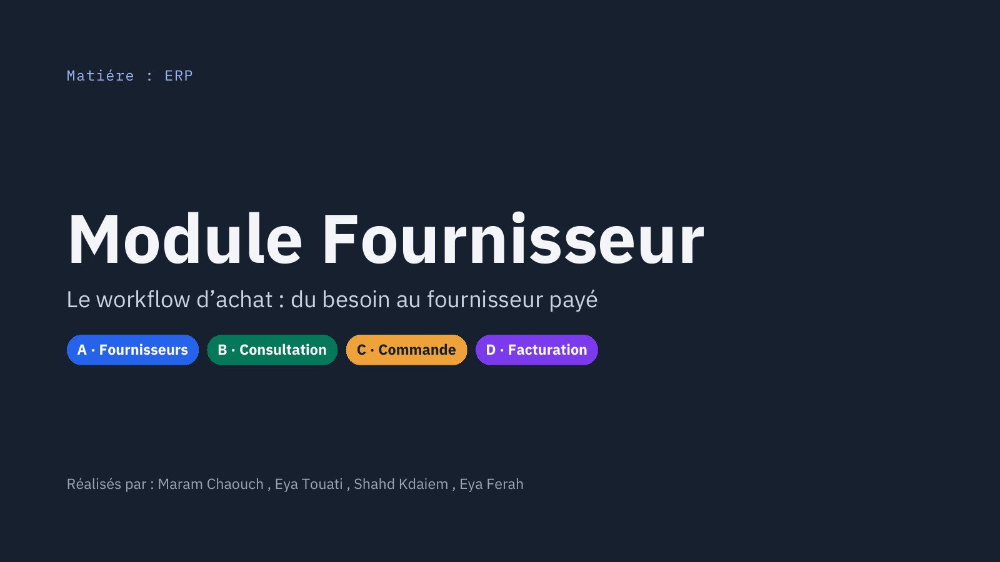
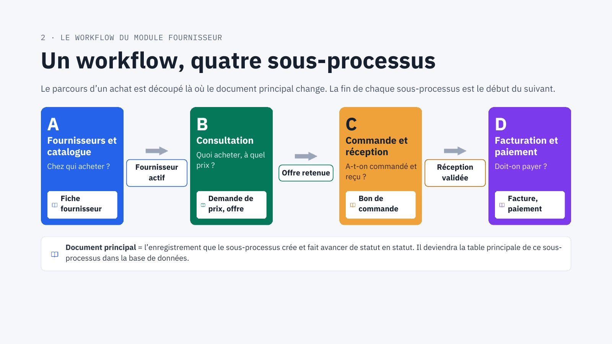
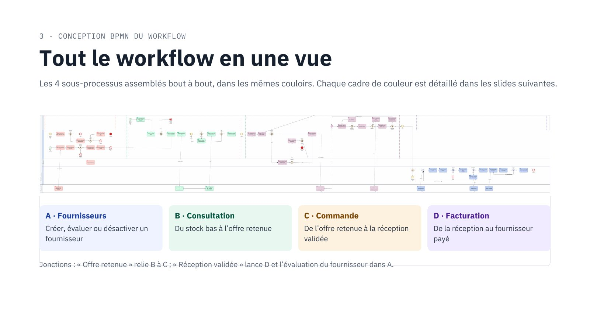
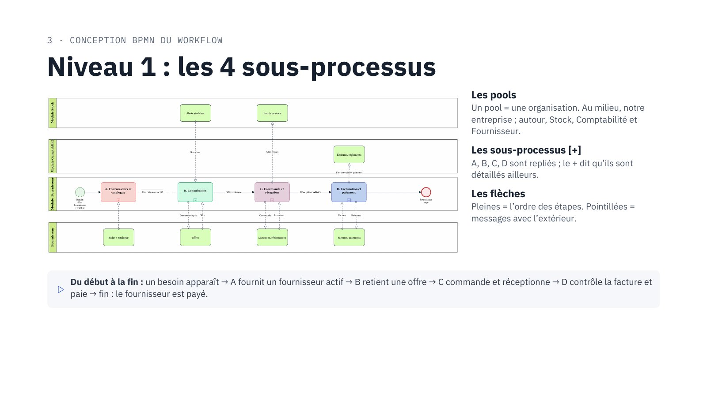
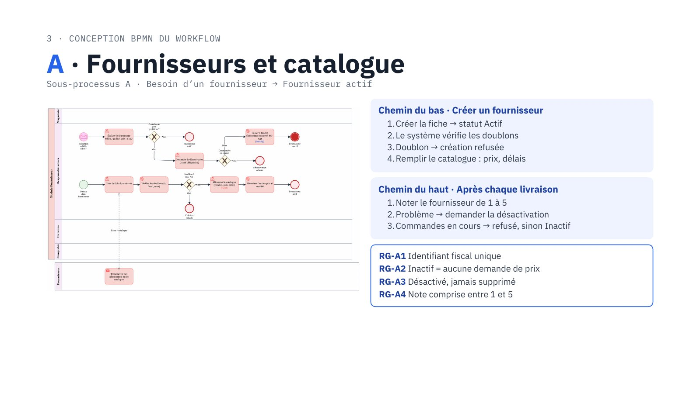
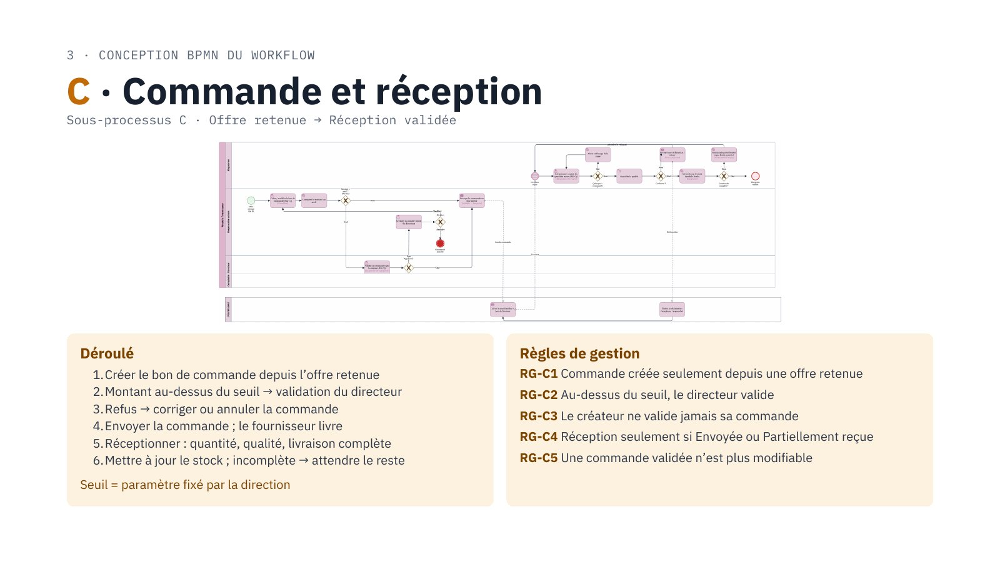
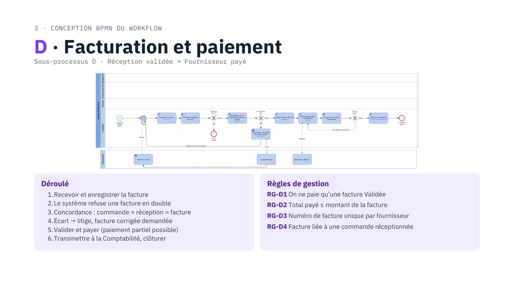
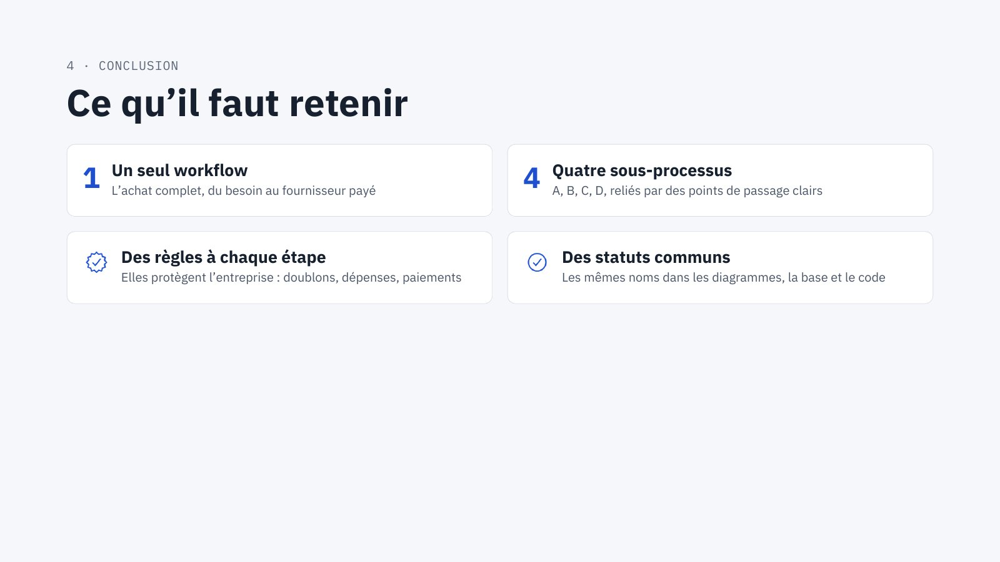

# ERP — Module Fournisseur

Projet de semestre, matière ERP. Le module Fournisseur gère tout le cycle d'achat de l'entreprise : du besoin d'achat jusqu'au fournisseur payé.

**Équipe :** Maram Chaouch · Eya Touati · Shahd Kdaiem · Eya Ferah

| Sous-processus | Rôle |
|---|---|
| A · Fournisseurs et catalogue | Créer, évaluer ou désactiver un fournisseur |
| B · Consultation | Du stock bas à l'offre retenue |
| C · Commande et réception | De l'offre retenue à la réception validée |
| D · Facturation et paiement | De la réception au fournisseur payé |

**Technologies :** Java 17 · Spring Boot 3 · PostgreSQL · Thymeleaf · Bootstrap

## Documents

| Document | Lien |
|---|---|
| Conception BPMN (diagrammes) | [docs/01-conception](docs/01-conception/) |
| Présentation (PDF) | [presentation.pdf](docs/02-presentation/presentation.pdf) |
| Speech de la présentation | [speech.pdf](docs/02-presentation/speech.pdf) |
| Choix des technologies | [choix-des-technologies.pdf](docs/04-technologies/choix-des-technologies.pdf) |

## Organisation du dépôt

```
docs/
├── 01-conception/      diagrammes BPMN (.drawio, images)
├── 02-presentation/    présentation et speech
└── 04-technologies/    choix des technologies
src/                    code Spring Boot (à venir)
```

## Présentation

**1. Couverture**



**2. Sommaire**


**3. Le module gère tout le cycle d'achat**


**4. Les échanges avec les autres modules**


**5. Workflow, sous-processus, tâche**


**6. Cinq acteurs, cinq couloirs BPMN**


**7. Un workflow, quatre sous-processus**



**8. Tout le workflow en une vue**



**9. Niveau 1 : les 4 sous-processus**



**10. A · Fournisseurs et catalogue**



**11. B · Consultation**


**12. C · Commande et réception**



**13. D · Facturation et paiement**



**14. Des statuts figés, décidés à quatre**


**15. Ce qu'il faut retenir**



**16. Merci**


