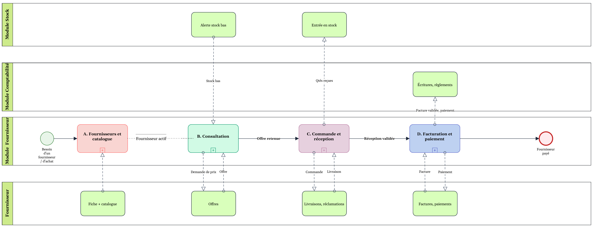
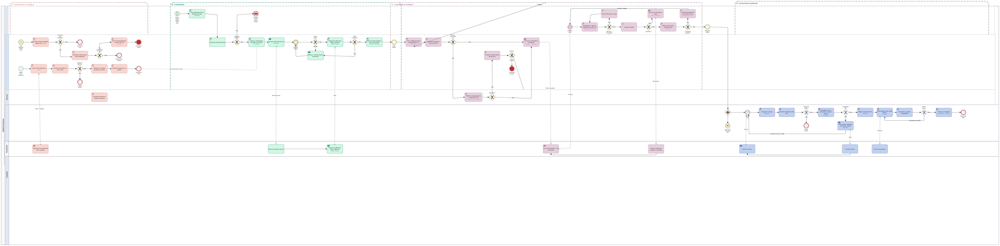
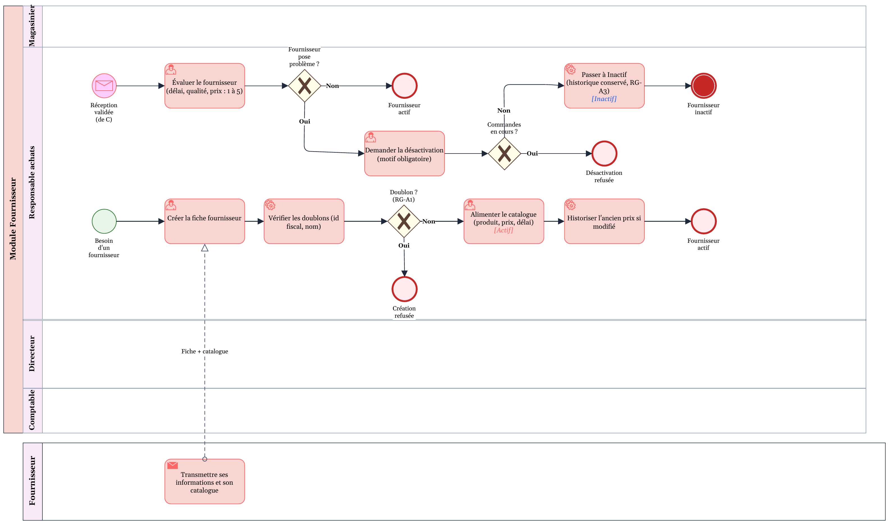
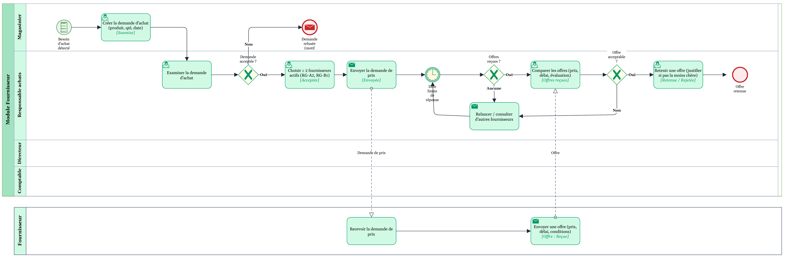
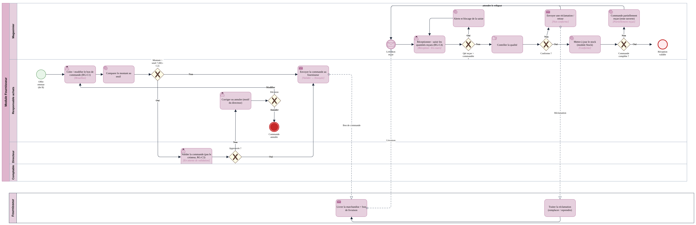
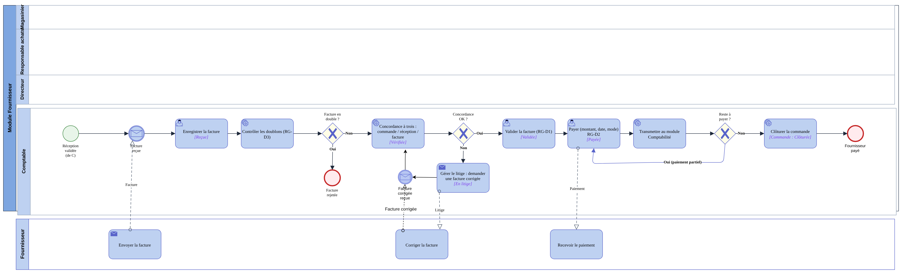

# Conception BPMN — Module Fournisseur

Un workflow (l'achat), découpé en 4 sous-processus : A, B, C et D.

- Source modifiable : [moduleFournisseur.drawio](moduleFournisseur.drawio) — à ouvrir avec draw.io (app.diagrams.net)
- Tous les diagrammes en PDF : [diagrammes-bpmn.pdf](diagrammes-bpmn.pdf)

## Niveau 1 — vue globale

## Vue complète

## A — Fournisseurs et catalogue

## B — Consultation

## C — Commande et réception

## D — Facturation et paiement

